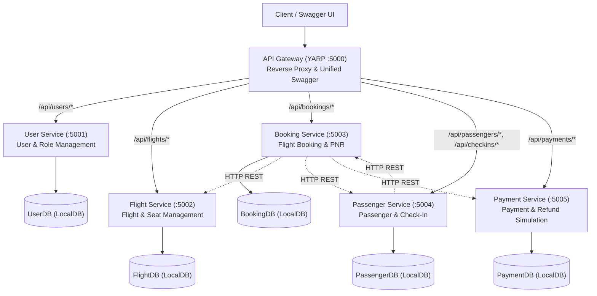

# FlightBookingSystem - Microservices Architecture

A complete, production-ready **Flight Booking System** built with **C# / .NET 10**, **ASP.NET Core Web API**, **Entity Framework Core 10**, **SQL Server 2022 (LocalDB)**, **YARP API Gateway**, **JWT Bearer Authentication**, **Role-based policies**, **Swagger UI**, and **NUnit**.

---

## 🏗 System Architecture & Microservices Overview

The solution adheres strictly to the **Microservices Architecture pattern** with **Database-per-Service**, clean **Layered Architecture (Controller -> Service -> Repository)**, **Dependency Injection**, **DTO Pattern**, and **Code-First EF Core Migrations**.



---

## 🗄 Database Per Service (SQL Server 2022 LocalDB)

Connection string base:
`Data Source=(localdb)\MSSQLLocalDB;Integrated Security=True;Persist Security Info=False;Pooling=False;MultipleActiveResultSets=False;Encrypt=True;TrustServerCertificate=True;`

| Microservice | Database Name | Tables | Description |
|---|---|---|---|
| **UserService** | `FlightBooking_UserDB` | `Role`, `User` | Role (`RoleId` PK, `RoleName`), User (`UserId` PK, `RoleId` FK, `FullName`, `Email`, `PasswordHash`, `PhoneNumber`, `CreatedAt`) |
| **FlightService** | `FlightBooking_FlightDB` | `Flight`, `FlightSeat` | Flight (`FlightId` PK, `FlightNumber`, `Airline`, `Source`, `Destination`, `DepartureTime`, `ArrivalTime`, `TotalSeats`, `BaseFare`, `IsActive`), FlightSeat (`SeatId` PK, `FlightId` FK, `SeatNumber`, `SeatClass`, `IsAvailable`, `SeatStatus`) |
| **BookingService** | `FlightBooking_BookingDB` | `Booking` | Booking (`BookingId` PK, `UserId`, `FlightId`, `BookingDate`, `TotalAmount`, `BookingStatus`, `PNR`) |
| **PassengerService** | `FlightBooking_PassengerDB` | `Passenger`, `CheckIn` | Passenger (`PassengerId` PK, `BookingId`, `PassengerName`, `Age`, `Gender`, `SeatNumber`), CheckIn (`CheckInId` PK, `BookingId`, `PassengerId` FK, `CheckInDate`, `CheckInStatus`) |
| **PaymentService** | `FlightBooking_PaymentDB` | `Payment` | Payment (`PaymentId` PK, `BookingId`, `Amount`, `PaymentMethod`, `TransactionId`, `PaymentStatus`, `PaymentDate`) |

---

## 🚀 Service Ports & Swagger Endpoints

| Service | Port | Base URL | Swagger UI URL |
|---|---|---|---|
| **API Gateway (YARP)** | **5000** | `http://localhost:5000` | `http://localhost:5000/swagger` |
| **User Service** | **5001** | `http://localhost:5001` | `http://localhost:5001/swagger` |
| **Flight Service** | **5002** | `http://localhost:5002` | `http://localhost:5002/swagger` |
| **Booking Service** | **5003** | `http://localhost:5003` | `http://localhost:5003/swagger` |
| **Passenger Service** | **5004** | `http://localhost:5004` | `http://localhost:5004/swagger` |
| **Payment Service** | **5005** | `http://localhost:5005` | `http://localhost:5005/swagger` |

> **Pro Tip**: Navigating to `http://localhost:5000/swagger` (API Gateway) provides a dropdown to inspect and test all 5 microservices' Swagger specifications in a single UI!

---

## 📋 Features Matrix (FR-01 to FR-14)

- **FR-01**: Customer registration (`POST /api/users/register`), login (`POST /api/users/login`) with JWT token issue, and secure Admin provisioning (`POST /api/users/admin`). Pre-seeded Admin: `admin@flightbooking.com` / `Admin@123456`.
- **FR-02**: Admin flight management: create (`POST /api/flights`), retrieve (`GET /api/flights/{id}`), update (`PUT /api/flights/{id}`), and deactivate (`POST /api/flights/{id}/deactivate`).
- **FR-03**: Flight search (`GET /api/flights/search?source=DEL&destination=BOM&date=...`) with indexed query.
- **FR-04**: Seat map retrieval (`GET /api/flights/{id}/seats`) showing Available, Held, and Booked seats.
- **FR-05**: Passenger distinct seat selection: duplicate seat selections in a single booking request are strictly rejected.
- **FR-06**: Full flight, passenger data, seat existence, and seat availability validation before booking.
- **FR-07**: Pending booking creation and atomic concurrency-safe seat hold in Flight Service.
- **FR-08**: Dummy payment simulation (`POST /api/payments/simulate`) supporting `Success` or `Failed` outcomes with idempotency protection.
- **FR-09**: On payment `Success`: booking confirmed, authoritative amount applied, and a unique 6-character PNR is generated.
- **FR-10**: On payment `Failed`: booking marked `Failed` and held seats are immediately released (compensating transaction).
- **FR-11**: Customers can retrieve (`GET /api/bookings/{id}`) and cancel (`POST /api/bookings/{id}/cancel`) only their own bookings; Admins can view any.
- **FR-12**: Cancellation records a simulated refund outcome and releases booked seats back to Available.
- **FR-13**: Check-in (`POST /api/checkins`) allowed only for Confirmed bookings with valid PNR and passenger ID; duplicate check-in is rejected; selected seat is retained.
- **FR-14**: Admins can view all bookings associated with a flight (`GET /api/bookings/by-flight/{flightId}`).

---

## 🧪 Testing with NUnit

The project includes an NUnit test suite with **27 comprehensive unit tests** and an explicit integration test covering all services:
- **UserServiceTests**: Registration, duplicate email rejection, login, BCrypt password verification, JWT generation, Admin provisioning, user profile.
- **FlightServiceTests**: Flight search validations, date filtering, auto seat layout generation, departure/arrival time rules, seat map, atomic seat hold, confirm, and release.
- **BookingServiceTests**: Duplicate seat rejection, authoritative amount calculation, payment success -> PNR generation, payment failure -> seat release compensating transaction, cancellation & refund.
- **PassengerServiceTests**: Bulk passenger persistence, check-in validation against PNR, duplicate check-in prevention, unconfirmed booking check-in rejection.
- **PaymentServiceTests**: Idempotency, Success simulation, Failed simulation, refund simulation.
- **DatabaseMigrationIntegrationTests**: LocalDB database creation, migration execution, and seed validation.

To run all tests:
```powershell
dotnet test
```

---

## 🏃 Running the Application

### Option A: Run All Services Simultaneously
Execute the PowerShell startup script:
```powershell
.\Start-AllServices.ps1
```
This opens each service and the API Gateway in its own window.

### Option B: Run Services Individually
```powershell
# Terminal 1 - User Service
cd src/Services/UserService
dotnet run --launch-profile http

# Terminal 2 - Flight Service
cd src/Services/FlightService
dotnet run --launch-profile http

# Terminal 3 - Booking Service
cd src/Services/BookingService
dotnet run --launch-profile http

# Terminal 4 - Passenger Service
cd src/Services/PassengerService
dotnet run --launch-profile http

# Terminal 5 - Payment Service
cd src/Services/PaymentService
dotnet run --launch-profile http

# Terminal 6 - API Gateway (YARP)
cd src/ApiGateway
dotnet run --launch-profile http
```

---

## 🧪 Swagger Testing Walkthrough

1. **Register or Login**:
   - `POST /api/users/register` with customer details.
   - Or `POST /api/users/login` with `admin@flightbooking.com` / `Admin@123456`.
   - Copy the `token` from the response.
   - In Swagger UI, click **Authorize** at the top right, enter `Bearer <token>`, and click **Authorize**.

2. **Search Flights & View Seat Map**:
   - `GET /api/flights/search?source=DEL&destination=BOM&date=2026-11-24`
   - `GET /api/flights/1/seats` to view available seats (`1A`, `1B`, `2A`, `2B`, etc.).

3. **Book a Flight**:
   - `POST /api/bookings` with:
     ```json
     {
       "flightId": 1,
       "paymentMethod": "CreditCard",
       "simulatePaymentOutcome": "Success",
       "passengers": [
         {
           "passengerName": "John Doe",
           "age": 30,
           "gender": "Male",
           "seatNumber": "1A"
         }
       ]
     }
     ```
   - Receive confirmed booking with unique **PNR** (e.g. `FL7K9Q`) and passenger ID.

4. **Passenger Check-In**:
   - `POST /api/checkins`:
     ```json
     {
       "pnr": "FL7K9Q",
       "passengerId": 1
     }
     ```
   - Confirms check-in and retains assigned seat `1A`.

5. **Cancel Booking**:
   - `POST /api/bookings/{id}/cancel` to cancel booking, trigger simulated refund, and release seats back to `Available`.
